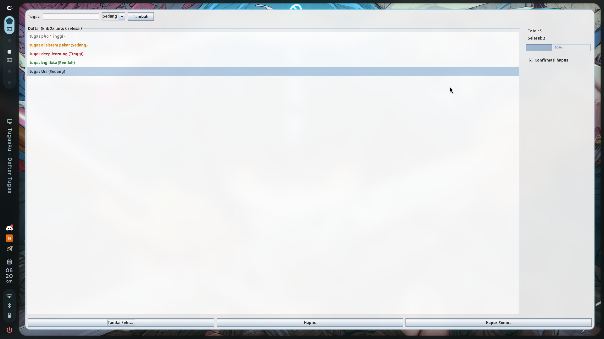
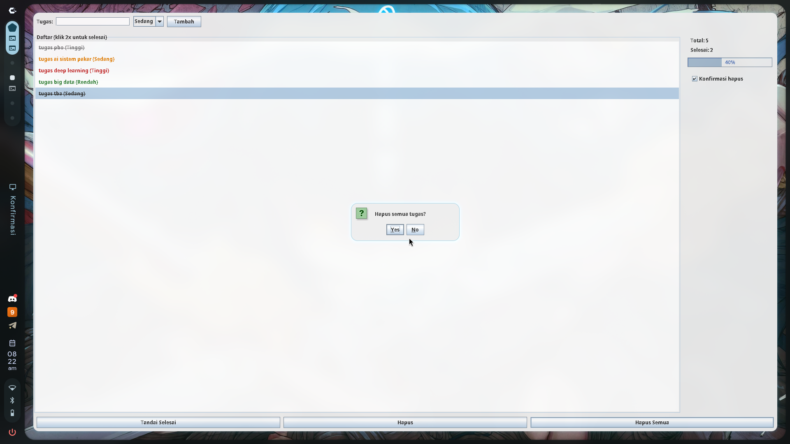

# TugasKu - Latihan GUI Java (Swing)

**NIM :** F1D02410063
**Nama :** Lalu Aditya Ramadhani

TugasKu adalah aplikasi daftar tugas (to-do list) sederhana berbasis Java Swing. Pengguna dapat menambah tugas dengan prioritas, menandai tugas selesai, menghapus tugas, dan melihat progres penyelesaian.

## Struktur File

| File | Keterangan |
|---|---|
| `TugasKuApp.java` | Class GUI utama (`JFrame`) dan method `main`. |
| `Tugas.java` | Class model untuk satu tugas, berisi nama, prioritas (`enum Prioritas`), dan status selesai. |

## Cara Menjalankan

```bash
javac TugasKuApp.java Tugas.java
java TugasKuApp
```

## Fitur

- Tambah tugas dengan prioritas Tinggi, Sedang, atau Rendah (tombol Tambah atau tekan Enter).
- Tandai selesai dengan tombol atau klik dua kali pada tugas. Tugas yang selesai dicoret dan berwarna abu-abu.
- Warna teks sesuai prioritas: merah (Tinggi), oranye (Sedang), hijau (Rendah).
- Hapus satu tugas atau semua tugas, dengan opsi konfirmasi.
- Penghitung Total, Selesai, dan progress bar persentase.

## 5 Komponen Utama GUI yang Digunakan

### 1. Top-level Container
| Class | Fungsi |
|---|---|
| `javax.swing.JFrame` | Jendela utama aplikasi. Class `TugasKuApp` meng-*extend* `JFrame`. |

### 2. Intermediate Container
| Class | Fungsi |
|---|---|
| `JPanel` | Mengelompokkan komponen: panel input, panel info, dan panel tombol. |
| `JScrollPane` | Membungkus `JList` agar daftar tugas bisa di-scroll. |

### 3. Atomic Component
| Class | Fungsi |
|---|---|
| `JLabel` | Teks label "Tugas:" dan penghitung (Total, Selesai). |
| `JTextField` | Input nama tugas. |
| `JComboBox` | Pilihan prioritas (berisi `Tugas.Prioritas`). |
| `JButton` | Tombol Tambah, Tandai Selesai, Hapus, dan Hapus Semua. |
| `JList` | Menampilkan daftar tugas dari `DefaultListModel<Tugas>`, dengan `ListCellRenderer` kustom. |
| `JCheckBox` | Opsi konfirmasi sebelum menghapus. |
| `JProgressBar` | Menampilkan persentase tugas yang selesai. |

### 4. Layout Classes
| Class | Dipakai pada |
|---|---|
| `BorderLayout` | `JFrame` (NORTH, CENTER, EAST, SOUTH). |
| `FlowLayout` | Panel input (komponen berjajar ke samping). |
| `BoxLayout` | Panel info (komponen tersusun vertikal). |
| `GridLayout` | Panel tombol (1 baris x 3 kolom). |

### 5. Event Listener
| Class / Interface | Method yang di-override | Fungsi |
|---|---|---|
| `ActionListener` (interface) | `actionPerformed()` | Aksi tombol Tambah, Tandai Selesai, Hapus, dan Hapus Semua. |
| `KeyAdapter` (adapter class) | `keyPressed()` | Tekan Enter di kolom input untuk menambah tugas. |
| `MouseAdapter` (adapter class) | `mouseClicked()` | Klik dua kali pada tugas untuk menandai selesai. |

## Screenshot



